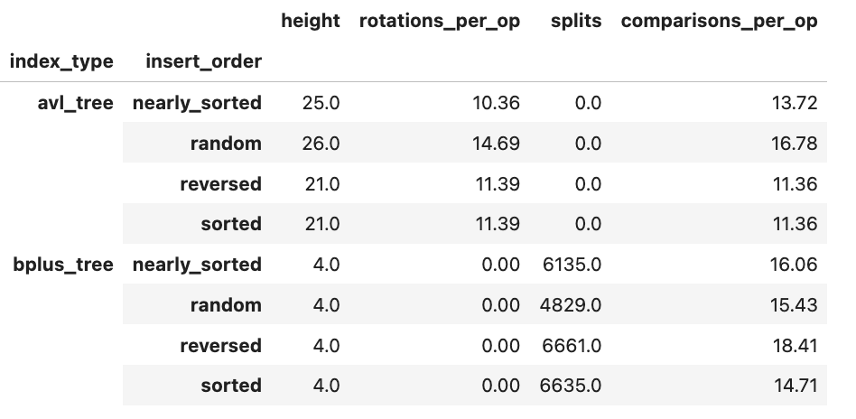
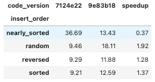

# INC-02: AVL rotations leave stale heights, causing excess rotations

## Summary

In `indexes/avl_tree.py`, both rotation functions refreshed node heights in the wrong order, so the stored heights were too large. As a result the AVL tree performed about 10 to 15 rotations per insert instead of about 1, and it grew taller than a valid AVL tree can be (height 26 for 100,000 keys, against a limit of about 24). Lookups still returned correct results, which is why the tests did not notice. Swapping two `_update_height` calls in each rotation fixed it: rotations per insert dropped to about 0.7 to 1.2 and the height to 17 to 20. Build time per insert at n = 100,000 improved for random (1.9x), reversed (1.3x) and sorted (1.4x) input, and nearly sorted input improved by about 1.3x once an outlier in the first post-fix run is accounted for (see Verification).

## Detection

I found it in experiment E5 (insert order), at n = 100,000 on code version `9e83b18`. The log-log slopes looked normal for an O(log n) structure (build k about 0.12 to 0.16, point lookups about 0.18 to 0.19), so the slope table did not flag the AVL tree. The counters did: `rotations_per_op` and `height` for `avl_tree` were far outside what AVL balancing allows, while the B+ tree rows from the same table (height 4, no rotations) looked normal. The bug raises the constant factor and not the growth rate, so slopes alone cannot find it.

## Expected vs. observed

Theory: an AVL tree with 100,000 keys has height at most 1.44 x log2(100,002), about 24, and needs about one rotation per insert or fewer.

Measured on the original code (E5 build, n = 100,000, medians over 5 replicates):

| insert order | height | rotations per op |
|---|---|---|
| random | 26 | 14.69 |
| nearly sorted | 25 | 10.36 |
| sorted | 21 | 11.39 |
| reversed | 21 | 11.39 |

Random and nearly sorted exceed the height bound, and every order does roughly 10 to 15 times the expected number of rotations.

## Evidence

- Experiment E5, code version `9e83b18`, machine `saariya-mbp`, n = 100,000.
- Figure (before the fix): 
- The B+ tree rows in the same table show height 4 and zero rotations, which makes the AVL rows stand out.
- The slope table (k about 0.12 to 0.19 for AVL) is also evidence: it looked normal, which shows why the counters were needed.

## Root cause

File `indexes/avl_tree.py`, functions `_rotate_right` (lines 62-63) and `_rotate_left` (lines 80-81).

After a rotation, two nodes swap places: one becomes the child of the other. A node's height is computed from its children's heights, so the node that moved down must be refreshed first and the node that moved up second. The original code did it the other way around: it recomputed the new parent first, using the new child's old, stale height, and only then corrected the child.

Tracing the insert of 10, 20, 30: before the left rotation at 10, node 10 has a stored height of 3. The rotation makes 20 the parent of 10. Node 20 is recomputed first, using 10's stale height of 3, so it gets 1 + 3 = 4. Then 10 is corrected to 1, but 20 stays at 4 when its true height is 2.

Later inserts read those inflated heights through `_balance`, see an imbalance that does not exist, and rotate again. The tree is still a valid binary search tree, so searches return correct answers. Only the performance is worse, which is why it costs time without producing wrong results.

## Fix

Commit `7124e22`, "Fix AVL rotations: refresh child height before parent". In each rotation, the node that moved down is now updated before the node that moved up. In `_rotate_right` (lines 62-63) the two `_update_height` calls now run on `y` first and then `x`; in `_rotate_left` (lines 80-81) they now run on `x` first and then `y`. Nothing else in the file changed.

## Verification

Same experiment (E5), same machine, same seeds, two code versions: `9e83b18` (before) and `7124e22` (after). Counters at n = 100,000, medians over 5 replicates:

| insert order | height before | height after | rotations per op before | rotations per op after |
|---|---|---|---|---|
| random | 26 | 20 | 14.69 | 0.7 |
| nearly sorted | 25 | 20 | 10.36 | 1.2 |
| sorted | 21 | 17 | 11.39 | 1.0 |
| reversed | 21 | 17 | 11.39 | 1.0 |

Figure (after the fix): 

Rotations fell by a factor of 9 to 21, and every height is now below the bound of about 24. For sorted and reversed input the height is 17, which is the minimum possible for 100,000 keys, so those trees are perfectly balanced. The B+ tree rows did not change, as expected, since only `avl_tree.py` was modified. `make test` still passes (168 passed, 3 skipped).

Build time per insert at n = 100,000 (median microseconds, 5 replicates), before (`9e83b18`) and after (`7124e22`): . The data is also in `analysis/timings_avl_after.csv`.

Three of the four orders got faster in the first run after the fix, as the lower rotation count predicts. Nearly sorted input measured about 2.7 times slower in that run (36.69 against 13.43 microseconds per insert), which the counters could not explain: its rotations per op (1.2) and comparisons per op (17.2) are only slightly above the other orders. That run also took 454 s against 355 s for the first run, which suggested a busier or hotter machine. I confirmed this by rerunning E5 twice more on the same AVL code: the nearly sorted build time at n = 100,000 came out at 10.18 microseconds (code `9174a5c`) and 10.70 microseconds (code `23e3aa3`). So the 36.69 was an outlier, and nearly sorted input is also faster than before the fix, by about 1.3x (13.43 to about 10.2 to 10.7 microseconds per insert). The deterministic counters above remain the primary evidence for the fix.

## Impact on recommendations

With the bug, the AVL tree looked worse than it really is: its builds did 10 to 15 times too many rotations and its tree was up to about 30 percent taller (26 levels against 20), so each lookup walked more nodes. That is a modest handicap on point lookups, which would probably not change which index wins, but it overstated AVL's build cost for random, sorted and reversed input. After the fix, AVL costs are in line with theory, so the AVL versus B+ tree comparison should use the post-fix data. The nearly sorted build time needs the rerun before it is used in any recommendation. TODO: after the final runs, check whether any F1 to F4 recommendation changes and say which.

## Why the tests didn't catch it

The tests check that inserts and lookups return the right results, and the buggy tree still did, because the stored heights only influence when rotations happen, not whether the tree stays a valid search tree. A test that would catch it: insert several thousand keys in each order, then assert that the tree height is at most 1.44 x log2(n + 2) and that rotations per insert stay at or below about one.