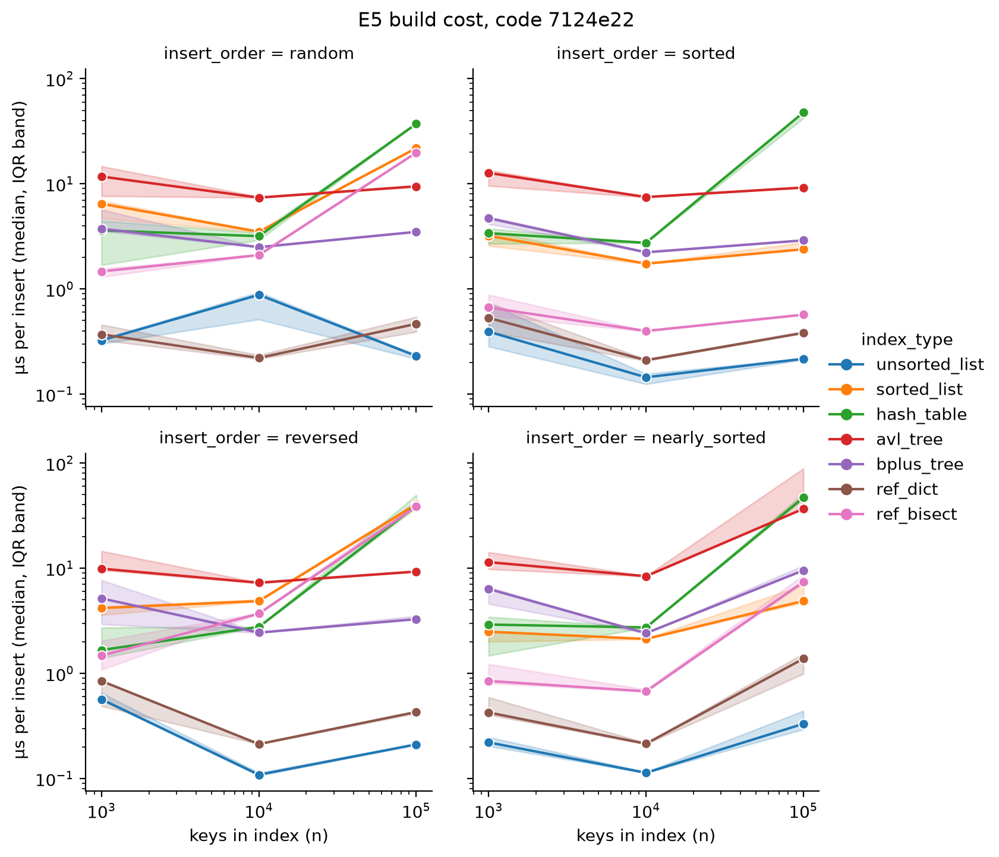
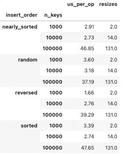
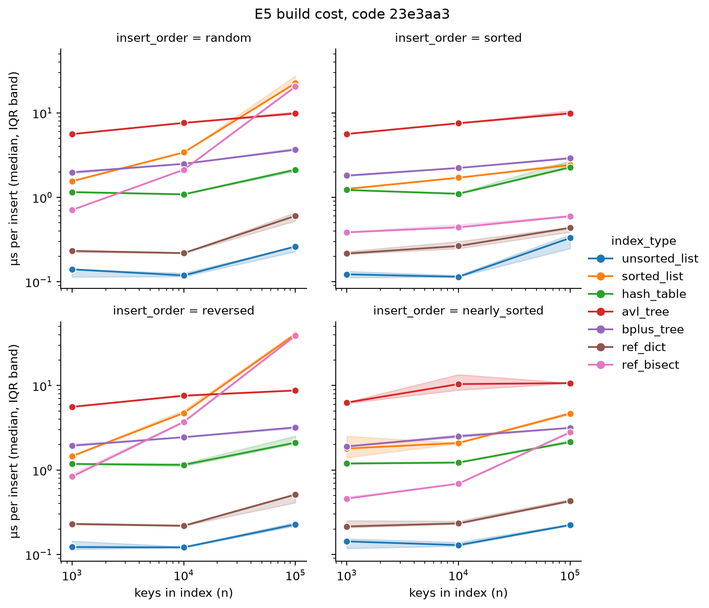
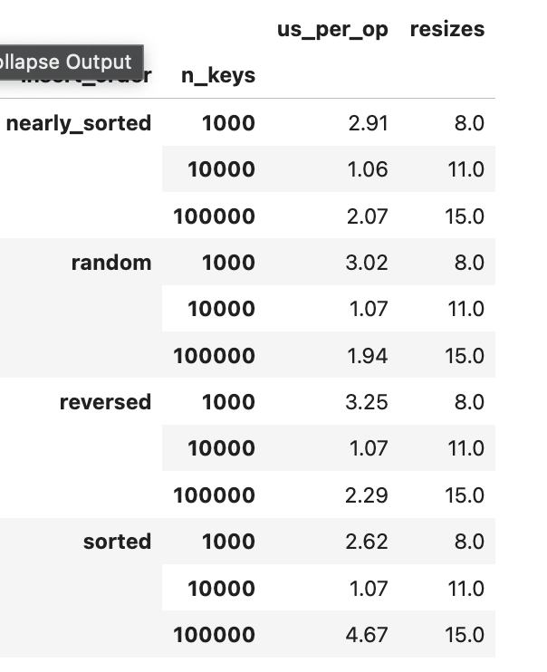

# INC-03: Hash table grows by a fixed step instead of doubling, making builds quadratic

## Summary

In `indexes/hash_table.py`, the `_grow` method added a fixed 1,024 buckets each time the table filled up, instead of doubling its capacity. The number of resizes therefore grew in proportion to n (131 resizes for 100,000 keys, against about 15 for a doubling table), and every resize rehashes all stored keys, so the total build work was quadratic. Build cost per insert rose from about 3 microseconds at n = 10,000 to 37 to 48 microseconds at n = 100,000. Lookups were not affected, because the load factor stayed below its limit. Replacing the fixed step with doubling brought the resizes down to 15 and the build cost at n = 100,000 down to about 2 microseconds per insert (1.9 to 4.7 in the first run after the fix, 2.1 to 2.3 in a rerun on the same hash table code), a speedup of 10x to 23x in the first run after the fix.

## Detection

Experiment E5 (insert order), and the build-cost plot on log-log axes. The `hash_table` line stayed flat at about 3 microseconds per insert for n = 1,000 and 10,000, then jumped to 37 to 48 microseconds at n = 100,000, in all four insert orders. The C-backed reference `ref_dict` stayed flat near 0.4 microseconds. The build slope table agreed: `hash_table` build had k of about 0.78 to 0.79 in every order, where a constant-time insert should be near 0. The `resizes` counter then pointed to the cause: resizes per insert barely fell as n grew (0.0020, 0.0014 and 0.0013 at n = 1,000, 10,000 and 100,000).

## Expected vs. observed

Theory: a hash table that doubles its capacity when it fills needs only about log2(n) resizes in total, and each insert costs O(1) on average, because the total rehashing work is bounded by about 2n. For 100,000 keys at a 0.75 maximum load factor, doubling from 8 buckets needs 15 resizes.

Observed on the original code (E5, code `7124e22`; the hash table file is identical in `9e83b18`), median over 5 replicates:

| insert order | build us per insert, n = 10,000 | build us per insert, n = 100,000 | growth | resizes at n = 1,000 / 10,000 / 100,000 |
|---|---|---|---|---|
| random | 3.18 | 37.19 | 11.7x | 2 / 14 / 131 |
| sorted | 2.74 | 47.65 | 17.4x | 2 / 14 / 131 |
| reversed | 2.76 | 39.29 | 14.2x | 2 / 14 / 131 |
| nearly sorted | 2.73 | 46.85 | 17.2x | 2 / 14 / 131 |

The number of resizes grew about tenfold for every tenfold increase in n, so it was proportional to n and not to log n. The cost per insert grew 12 to 17 times between n = 10,000 and n = 100,000, where a constant-time insert should barely change.

## Evidence

- Build-cost figure, `hash_table` against `ref_dict`, before the fix: 
- Table of build time per insert and total resizes for every insert order and size, before the fix: 
- Build slope table: `hash_table` k of about 0.78 in all four insert orders.
- Code versions used: `7124e22` (before) and `9174a5c` (after, the fix commit), with a rerun on `23e3aa3` (same hash table code as `9174a5c`); machine `saariya-mbp`.

## Root cause

File `indexes/hash_table.py`: the constant `GROWTH_STEP = 1024` and the first line of `_grow`, which computed the new capacity as the old capacity plus `GROWTH_STEP`.

The table starts with 8 buckets and checks the load factor after every insert. When the number of keys exceeds 0.75 times the number of buckets, `_grow` builds a new bucket list and rehashes every key into it. The new size was the old size plus 1,024, not a multiple of the old size. After the first resize (8 to 1,032 buckets), each further resize happened only after about another 768 inserts (1,024 buckets times a 0.75 load factor). So the number of resizes grew like n / 768, and each one moved every key already stored, so the total work grew like n squared.

The bug is easy to miss for three reasons. First, the first step is large relative to small tables, so at n = 1,000 there were only 2 resizes and nothing looked wrong. Second, the table still grew and kept a healthy load factor, so every lookup stayed fast and every answer was correct. Third, the docstring says the table adds more buckets, which a fixed step satisfies.

## Fix

Commit `9174a5c`, "Fix hash table growth: double capacity instead of adding a fixed step". In `_grow`, the new capacity is now the old capacity multiplied by 2, instead of the old capacity plus `GROWTH_STEP`. It is a one-line change (one insertion, one deletion). Nothing else in the file changed.

## Verification

Same experiment (E5), same machine, same seeds, two code versions: `7124e22` (before) and `9174a5c` (after). Median over 5 replicates:

| insert order | build us per insert, n = 100,000, before | after | speedup | resizes at n = 1,000 / 10,000 / 100,000, after |
|---|---|---|---|---|
| random | 37.19 | 1.94 | 19x | 8 / 11 / 15 |
| sorted | 47.65 | 4.67 | 10x | 8 / 11 / 15 |
| reversed | 39.29 | 2.29 | 17x | 8 / 11 / 15 |
| nearly sorted | 46.85 | 2.07 | 23x | 8 / 11 / 15 |

The resizes match the prediction for a doubling table exactly: 8, 11 and 15 for n = 1,000, 10,000 and 100,000, growing like log2(n) instead of like n. At n = 10,000 the build cost fell from about 2.7 to 3.2 microseconds to about 1.06 to 1.07 microseconds per insert in every order.

After the fix, the cost per insert grows only 1.8x to 2.1x from n = 10,000 to n = 100,000 for random, reversed and nearly sorted input, against 12x to 17x before. Sorted input grew 4.4x (1.07 to 4.67 microseconds), more than the other orders. I reran E5 on the same hash table code (code `23e3aa3`, which differs from `9174a5c` only in `sorted_list.py`), and the sorted build at n = 100,000 came out at 2.27 microseconds (replicates 2.1 to 2.9), in line with the other orders (2.11 to 2.14). All five replicates in the first run were between 4.5 and 5.7 microseconds, so the machine was slower for that whole stretch of the run, and the counters are identical across insert orders. So the 4.67 was a transient slowdown, not a property of sorted input. In the rerun the cost per insert grows 1.8x to 2.1x from n = 10,000 to n = 100,000 in every order. Resizes at n = 1,000 rose from 2 to 8 with doubling, because the old fixed step jumped straight to 1,032 buckets; those small resizes are cheap and the cost per insert at n = 1,000 is unchanged (about 3 microseconds).

After the fix, the build-cost figure, from the rerun on `23e3aa3` (its hash table code is identical to the fix commit `9174a5c`):  and the table of build time and resizes from the first run after the fix (`9174a5c`), which is the one in the table above: 

`make test` still passes (168 passed, 3 skipped).

## Impact on recommendations

With the bug, the hash table looked much worse for building large indexes than it really is: its build cost per insert grew with n, while a correct hash table stays flat like `ref_dict`. This would have understated the hash table in any comparison that includes build time (the build and memory experiment E1 and any recommendation for build-heavy workloads). Point lookups were not affected, because the load factor stayed below 0.75 either way, so the point-lookup recommendation (F1) does not depend on this fix. Doubling has a cost in memory: at n = 100,000 the fixed-step table held about 134,000 buckets at a load factor of 0.75, while the doubling table holds 262,144 buckets at a load factor of about 0.38, roughly twice as many empty buckets. That is the usual trade-off of doubling, and it should be mentioned wherever `memory_bytes` from E1 is compared.

## Why the tests didn't catch it

The tests check that inserts and lookups return correct results, and the table with fixed-step growth still did: only the number of resizes and the time differed. A test that would catch it: insert several thousand keys and assert that the number of resizes stays below about 2 x log2(n), or that every growth step at least doubles the capacity.