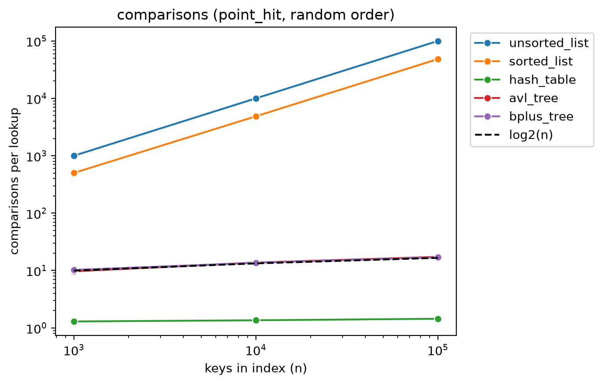
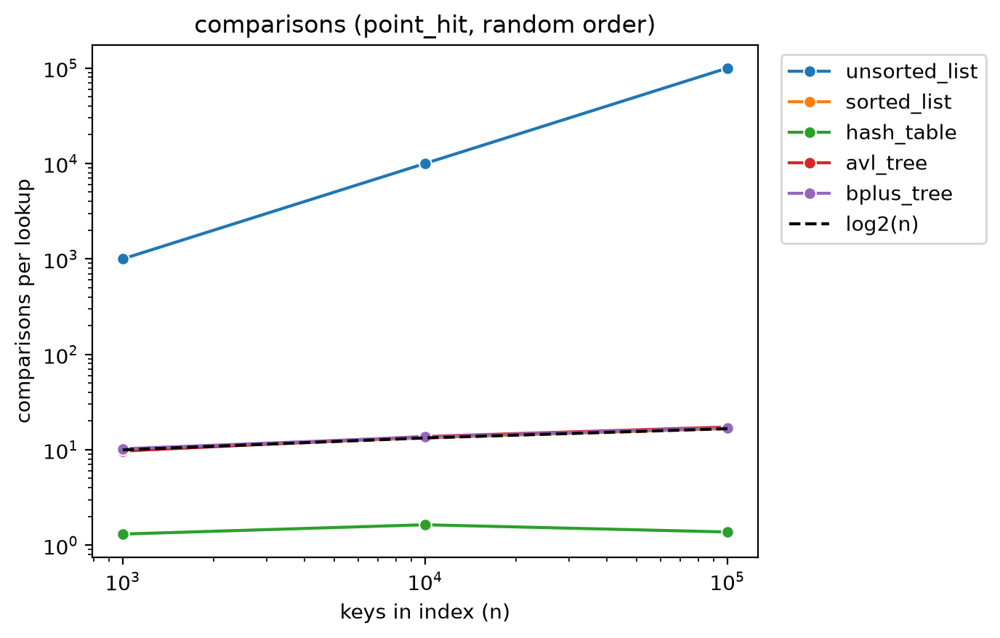
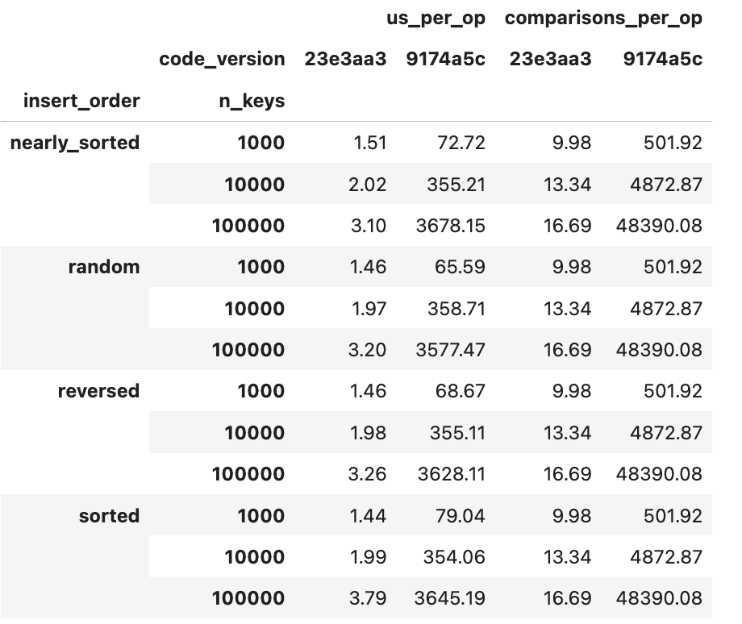

# INC-04: Sorted list search scans linearly instead of using binary search

## Summary

In `indexes/sorted_list.py`, the `search` method walked the list from the first key and compared each key in turn, even though the keys are sorted and the class already has a binary search, `_bisect_left`, that `insert` and `range_search` use. A point lookup therefore cost about n/2 comparisons (48,390 at n = 100,000) instead of about log2(n) (16.7), and took about 3.6 milliseconds per lookup at that size, as slow as the unsorted list. Replacing the loop with a call to `_bisect_left` fixed it: lookups now take 16.69 comparisons and about 3 to 4 microseconds at n = 100,000, roughly 1,000 times faster. Results were correct before and after, which is why the tests did not notice.

## Detection

Experiment E5 (insert order), in the point-lookup plot and the counters plot. On the log-log point-lookup plot, the `sorted_list` line rose together with `unsorted_list`: about 70 microseconds at n = 1,000, about 360 at n = 10,000 and about 3,700 at n = 100,000, a slope of about 1. The reference `ref_bisect`, which does the same job with Python's C-backed binary search, stayed near 0.5 to 1 microsecond. The `comparisons` plot then showed why: the `sorted_list` line ran at about n/2 comparisons per lookup, while AVL tree and B+ tree sat on the dashed log2(n) line.

## Expected vs. observed

Theory: binary search over a sorted array costs O(log n), about log2(n) comparisons per lookup: 10.0, 13.3 and 16.6 at n = 1,000, 10,000 and 100,000.

Observed on the original code (E5, code `9174a5c`, point lookups that all hit, median over 5 replicates), identical in all four insert orders because the list is sorted whatever order the keys arrive in:

- n = 1,000: 501.92 comparisons per lookup, about 65 to 79 microseconds
- n = 10,000: 4,872.87 comparisons per lookup, about 355 microseconds
- n = 100,000: 48,390.08 comparisons per lookup, about 3,580 to 3,680 microseconds

That is about n/2 comparisons, the average position of a key that is present, so the lookup was a linear scan.

## Evidence

- Counters plot, comparisons per lookup against n with the log2(n) line, before the fix (random order): 
- The same plot after the fix: . The `sorted_list` line now lies on the dashed log2(n) line, under the AVL tree and B+ tree lines, so it is hard to see; only `unsorted_list` is still linear.
- Table of lookup time and comparisons per lookup, before (`9174a5c`) and after (`23e3aa3`) the fix, for every insert order and size: 
- Machine `saariya-mbp`. The `sorted_list.py` file is the original in `9174a5c`, since the earlier fixes touched other files. The before plot was generated from code `7124e22`, whose `sorted_list.py` is identical to the one in `9174a5c`.

## Root cause

File `indexes/sorted_list.py`, method `search` (about lines 53 to 65).

`search` looped over `self._keys` with `enumerate`, counting a comparison for each key, and returned when the key matched. The comment above it says that because the keys are sorted it can stop once it has passed the place where the key would be, and the loop has a `break` for that. That is true, but it only helps a lookup for a missing key near the front: a lookup for a key that is present still examines every key before it, so it costs its position in the list, about n/2 on average.

The class already has `_bisect_left`, which finds the position in about log2(n) steps, and `insert` and `range_search` both use it. Only `search` did not. The answers were correct, only slow, and the class docstring even claims the list is searched with binary search, so reading the code quickly would not reveal the problem.

## Fix

Commit `23e3aa3`, "Fix sorted list search: use binary search instead of a linear scan". The loop in `search` is replaced by one call to `_bisect_left` to find the position where the key would be, followed by one check whether the key stored at that position is the one asked for; if it is, `search` returns its values, otherwise it returns an empty list. Nothing else in the file changed.

## Verification

Same experiment (E5), same machine, same seeds, two code versions: `9174a5c` (before) and `23e3aa3` (after), shown in the table image above. Median over 5 replicates, at n = 1,000 / 10,000 / 100,000:

- Comparisons per lookup: 501.92 / 4,872.87 / 48,390.08 before, and 9.98 / 13.34 / 16.69 after. The after values match log2(n) (10.0, 13.3, 16.6), in every insert order.
- Time per lookup: about 65 to 79 / 355 / 3,580 to 3,680 microseconds before, and about 1.5 / 2.0 / 3.1 to 3.8 microseconds after.

At n = 100,000 the lookup is about 960 to 1,190 times faster depending on the insert order (nearly sorted 1,190x, random 1,120x, reversed 1,110x, sorted 960x), and the time per lookup now grows only from about 1.5 to about 3.2 microseconds over a hundredfold increase in n, as an O(log n) structure should. `make test` still passes (168 passed, 3 skipped).

## Impact on recommendations

With the bug, the sorted list looked exactly as slow as the unsorted list for point lookups (both linear), so it would have been ranked with the unsorted list and dismissed for the point-lookup feature (F1). After the fix its lookups cost about the same order as the trees (log n) and are only a few microseconds at n = 100,000. The trade-off that the bug was hiding is unchanged by the fix: inserting into the middle of a Python list shifts every later key, so building a sorted list from random or reversed input still costs more per insert as n grows, while the trees and the hash table do not. So after the fix the sorted list is a competitive choice for point lookups and ranges on data that is loaded once and read many times, but not for workloads that insert heavily. This should be checked against the F1 and F3 recommendations once the final runs are in.

## Why the tests didn't catch it

The tests check that `search` returns the right values, and the linear scan does. The bug affects only how many comparisons and how much time a lookup takes. A test that would catch it: build a sorted list of several thousand keys, reset the statistics, look up a key and assert that the number of comparisons is at most about 2 x log2(n), not n/2.